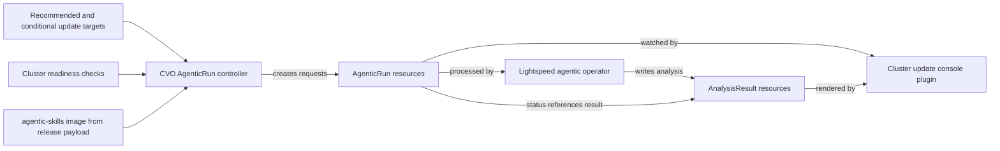

# AgenticRun update assessments

An [AgenticRun](https://github.com/openshift/lightspeed-agentic-operator) is a custom resource defined and processed
by the Lightspeed agentic operator. CVO creates AgenticRun requests to assess possible cluster updates; it does not
perform the AI analysis itself or initiate a cluster update through these requests.

## Creation and lifecycle

The [AgenticRun controller](../../pkg/agenticrun/controller.go) checks for the AgenticRun CRD and reads the
`agentic-skills` image from the release payload's [`image-references`](../../install/image-references). It creates
runs only when the CRD and skills image are available. CVO skips new runs while `ClusterVersion` is `Progressing`,
so the readiness data does not reflect a transient update state.

For each recommended or conditional update target, CVO gathers [cluster readiness data](../../pkg/readiness/) and
creates an AgenticRun with the current and target versions, update channel, assessment prompt, and skills image. The
prompt asks for an upgrade risk assessment and remediation plan. Runs are created in `openshift-lightspeed` by
default; `LIGHTSPEED_AGENTIC_RUN_NAMESPACE` overrides the namespace.

CVO labels the runs it creates. On a later sync, it replaces runs older than 24 hours for current recommended or
conditional targets. It removes CVO-owned runs for targets that are no longer relevant, but retains runs associated
with versions in the `ClusterVersion` update history. Runs retained solely because of history are not refreshed;
runs created by other components are left alone.

The agentic operator records progress in `AgenticRun.status`, including references to per-step result resources.
CVO does not read the results back. The [cluster update console plugin](https://github.com/openshift/cluster-update-console-plugin/blob/770c09fa8741e3167dad266dc931b6ed036d3884/src/components/update-plan/UpdatePlanTab.tsx)
watches AgenticRuns and AnalysisResults, follows a run's latest analysis result reference, and renders the assessment.

The same CVO controller also [deploys the cluster update console plugin](cluster-update-console-plugin.md) on
supported clusters. The plugin has a separate image and deployment lifecycle; the AgenticRun CRD's presence is one
of its deployment conditions.
