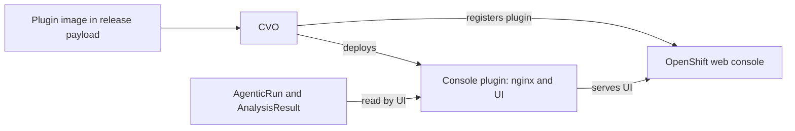

# Cluster update console plugin

CVO manages the `cluster-update-console-plugin`, a dynamic OpenShift console plugin that adds an update page to the
web console. It shows update plans with readiness and risk information and operator compatibility when that data is
available. The views and actions shown can vary by release and enabled features. The UI source and its development
instructions live in the separate
[openshift/cluster-update-console-plugin repository](https://github.com/openshift/cluster-update-console-plugin).

The plugin runs in the `openshift-cluster-update-console-plugin` namespace. Its container serves the plugin assets
with nginx over HTTPS on port 9001. The UI assets come from the `cluster-update-console-plugin` image in the release
payload; this repository contains the manifests and nginx configuration used to deploy that image.

## Deployment and lifecycle

The same CVO controller also [creates AgenticRun update assessments](agentic-runs.md). CVO checks that the
AgenticRun CRD exists before deploying the plugin. The plugin uses its own image from the release payload and is
added to the console operator's `spec.plugins` once its deployment has an available replica.

The [AgenticRun controller](../../pkg/agenticrun/controller.go) deploys the plugin when the AgenticRun CRD exists,
the cluster version has major version 5 or later, the Console capability is enabled, and the cluster is not
HyperShift. CVO reads the image from the `cluster-update-console-plugin` entry in the release payload's
[`image-references`](../../install/image-references). If the image is unset, the controller cannot deploy the plugin.

The controller applies the [embedded manifests](../../pkg/agenticrun/bindata/assets/) for the namespace, service
account, network policies, nginx ConfigMap, deployment, service, and `ConsolePlugin` resource. Once the deployment
has an available replica, CVO adds the plugin to `spec.plugins` of the console operator's `cluster` configuration.
When the AgenticRun CRD is absent, CVO attempts to remove the plugin from that list and cleans up its manifests only if removal succeeds.

The [nginx ConfigMap](../../pkg/agenticrun/bindata/assets/configmap.yaml) serves files from
`/usr/share/nginx/html` using the serving certificate requested by the
[Service](../../pkg/agenticrun/bindata/assets/service.yaml). CVO renders nginx's TLS protocols and ciphers from the
cluster's APIServer TLS security profile. It uses the Intermediate profile if it cannot read the APIServer config.
A change to the rendered configuration updates the deployment's config hash so the pods roll out with the new
configuration. The [ConsolePlugin resource](../../pkg/agenticrun/bindata/assets/consoleplugin.yaml) points the
console at the service on port 9001.
